# EraseLoop

[](https://github.com/4Asterion/eraseloop/actions/workflows/ci.yml)


[](LICENSE)

**Your "delete my account" button returns 200. Is the data actually gone — from the database, the cache, the object store — and does it stay gone?**

EraseLoop is a regression test for data deletion. It creates a **synthetic** user through your API, proves every configured store holds its data, deletes it through your API, then keeps watching. It catches the two bugs that unit tests miss: data that is **never deleted** from one store, and data that **comes back** — from a retry job, a cache refill or a stale replica.

<p align="center"></p>

Zero dependencies (Node 22+). Safe defaults: localhost targets only, synthetic identities only.

## Quick start

```sh
git clone https://github.com/4Asterion/eraseloop
cd eraseloop
npm test
REAPPEAR=1 npm run demo        # a demo API that "forgets" to delete properly
```

In another terminal:

```sh
node src/cli.js run --config examples/demo-config.json --format html --output deletion-report.html
```

Start the demo without `REAPPEAR=1` to see a passing run. Your own app only needs two **test-only** endpoints: one that creates a synthetic identity and one that deletes it.

## How it works

```text
CREATE synthetic identity via your API
        ↓
BASELINE  every probe must see the data (no false "deleted" for data that never existed)
        ↓
DELETE via your API
        ↓
OBSERVE  every store, every intervalMs, for durationMs (after an optional graceMs)
        ↓
PASS / FAIL / INCONCLUSIVE per probe + timeline report
```

| Probe | Checks | Requires |
|---|---|---|
| `http` | JSON count/boolean, or 404 vs 2xx | nothing |
| `postgres` | parameterised read-only `COUNT(*)` | `psql` |
| `redis` | `EXISTS` on an exact subject-scoped key | `redis-cli` |
| `s3` | `HeadObject` on an exact subject-scoped key (AWS, MinIO, R2, …) | AWS CLI |

Asynchronous deletion? Set `"graceMs"`: data may linger that long, but must be gone afterwards — and reappearing after it was gone always fails. See [docs/CONFIGURATION.md](docs/CONFIGURATION.md).

## In CI

```sh
node src/cli.js run --config tests/deletion.json --format junit --output eraseloop.xml      # test-report tabs
node src/cli.js run --config tests/deletion.json --format markdown >> "$GITHUB_STEP_SUMMARY"
```

Formats: `text`, `json` (schema v1), `html`, `markdown`, `junit` (one test case per probe, so the failing store is named).

| Exit | Meaning |
|---|---|
| `0` | Every probe was present at baseline, then absent after the grace period and never reappeared |
| `1` | A probe still held the data or the data reappeared |
| `2` | Invalid configuration, arguments or report destination (checked **before** any API call) |
| `3` | Inconclusive: missing baseline, failed lifecycle call, or a probe that could not prove absence |

This repository's own CI runs EraseLoop against real PostgreSQL, Redis and S3-compatible (S3Mock) containers, for both a clean deletion and a delayed resurrection ([integration/](integration/README.md)).

## Safety first

- Only `localhost`, `127.0.0.1` and `::1` targets by default. Remote targets need **HTTPS** and `--ack-remote-test-only`. Never point it at production accounts.
- Redirects are refused, so bearer tokens can't be forwarded cross-origin. Tokens come from environment variables and never appear in reports.
- Probes query exact, subject-scoped keys only: no wildcards, scans or user-supplied commands. SQL identifiers are restricted; values are bound through `psql` variables. CLI adapters run without a shell.
- `unknown` is never treated as deleted. A missing baseline makes the run inconclusive and triggers a best-effort cleanup delete.

An absence result covers **the configured stores and observation window only**. It is not proof of erasure from backups, logs or third parties, and not a legal compliance certificate. Read [SECURITY.md](SECURITY.md) before connecting to anything beyond localhost.

## Development

```sh
npm run check
npm test
node --experimental-test-coverage --test tests/*.test.js
```

See [docs/ARCHITECTURE.md](docs/ARCHITECTURE.md), [CONTRIBUTING.md](CONTRIBUTING.md), [docs/ROADMAP.md](docs/ROADMAP.md) and [CHANGELOG.md](CHANGELOG.md). MIT licensed.
